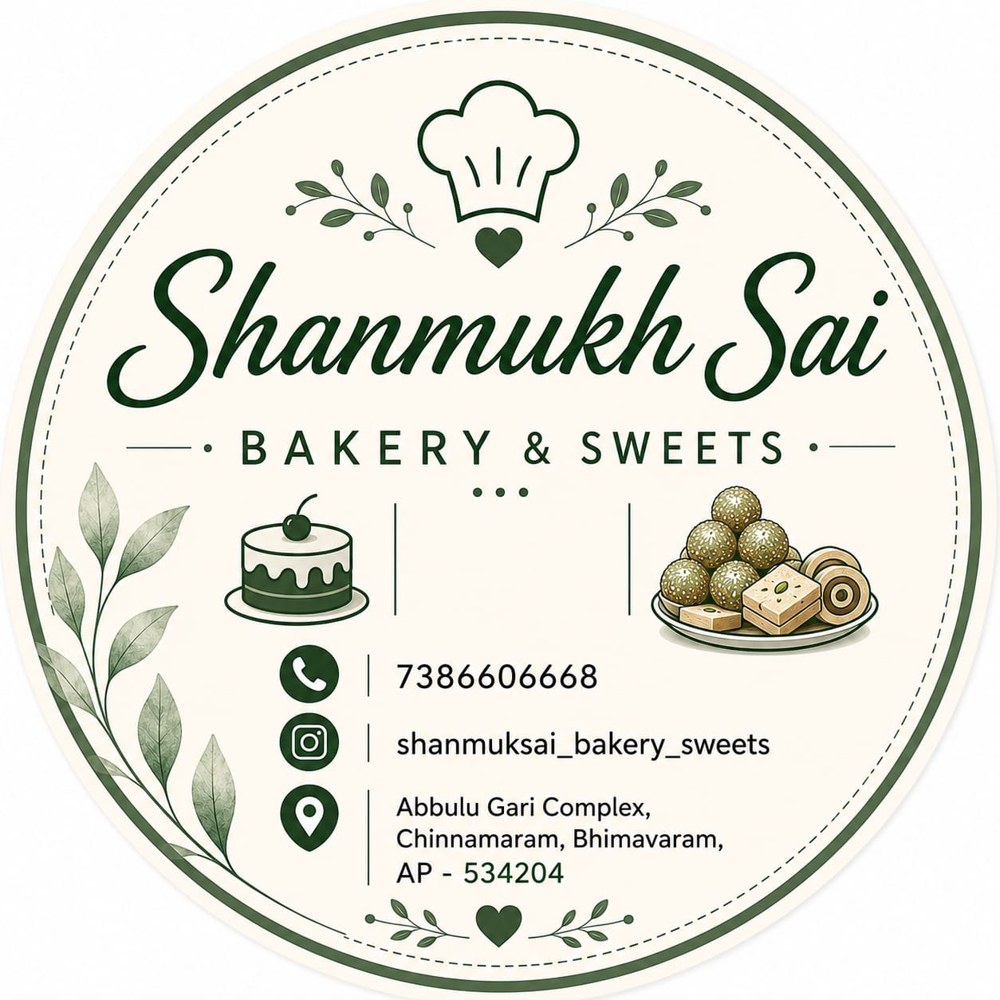

# Shanmukha Sai Bakery & Sweets Website 🎂🍰🥐

A modern, responsive, and interactive website for **Shanmukha Sai Bakery & Sweets**, located in Bhimavaram, Andhra Pradesh.



## 🌟 Features

- **Animated Welcome Intro Screen:**
  - Displays the official Shanmukha Sai Bakery logo with a rotating golden ring and ambient warm glow.
  - Smooth 2.5-second welcome animation with graceful auto-fadeout into the main website.
  - Fully accessible with reduced-motion support and quick skip options.

- **Bakery Introduction & Hero Showcase:**
  - Headline: *"Freshly Baked, Made with Love"*.
  - Artisan culinary photography showcasing daily bakes, pure ghee mithai, and celebration cakes.
  - Direct calls-to-action to explore products and initiate WhatsApp inquiries.

- **Interactive Product Categories:**
  - **Cakes:** Handcrafted celebration cakes, Belgian chocolate truffle, black forest, and fresh cream pastries.
  - **Sweets:** Traditional pure desi ghee sweets, diamond Kaju Katli, saffron Motichoor Laddus, and Mysore Pak.
  - **Hots:** Oven-fresh flaky veg puffs, spicy egg puffs, golden paneer puffs, and Andhra mixture.

- **Interactive Product Lift & Pop-Up Effect:**
  - Clicking any product card causes it to float upward with a warm caramel shadow and glowing border ring.
  - Unlocks an immediate **"Click for More Info"** WhatsApp enquiry button.
  - Allows seamless selection transitions and quick deselect without layout jumps.

- **Direct WhatsApp Product Enquiry:**
  - Click-to-chat integration targeting **+91 9676662334**.
  - Prefilled, URL-encoded product names (e.g. `Can I get more info about this product? Product: Signature Chocolate Truffle Cake`).

- **Verified Business Information & Location:**
  - **Address:** Abbulu Gari Complex, Chinnamaram, Bhimavaram, AP - 534204
  - **Phone:** +91 73866 06668
  - **WhatsApp:** +91 9676662334
  - **Instagram:** [@shanmuksai_bakery_sweets](https://www.instagram.com/shanmuksai_bakery_sweets)

---

## 🛠️ Tech Stack

- **Framework:** React 19 + Vite
- **Styling:** Vanilla CSS with a tailored bakery color palette (warm cream, chocolate brown, caramel gold)
- **Icons:** Lucide Icons & custom SVG components
- **Design Tokens:** Smooth micro-animations, glassmorphism navbar, and mobile-first responsive layout

---

## 🚀 Getting Started

### 1. Install dependencies:
```bash
npm install
```

### 2. Run the development server:
```bash
npm run dev
```

### 3. Build for production:
```bash
npm run build
```
